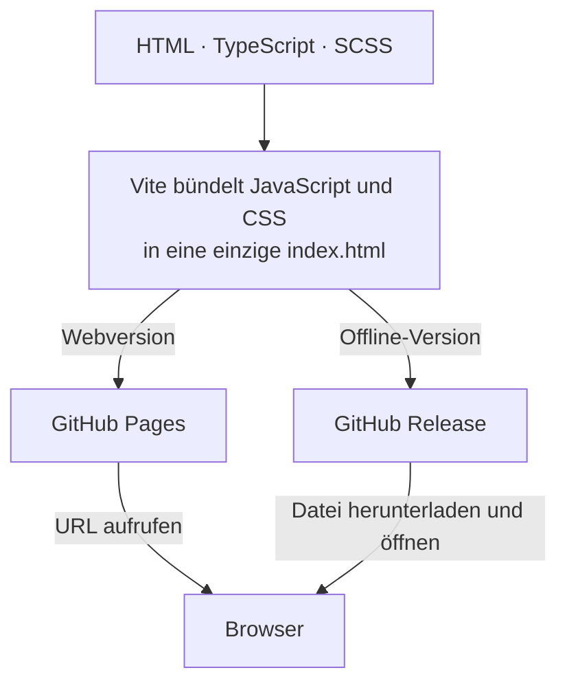

# Wie entsteht die App?

[Build-Konfiguration](../../vite.config.js) · [Auslieferung auf GitHub Pages](../../.github/workflows/pages.yml) · [Release der HTML-Datei](../../.github/workflows/release.yml)

[← Architekturübersicht](../../ARCHITECTURE.md)
