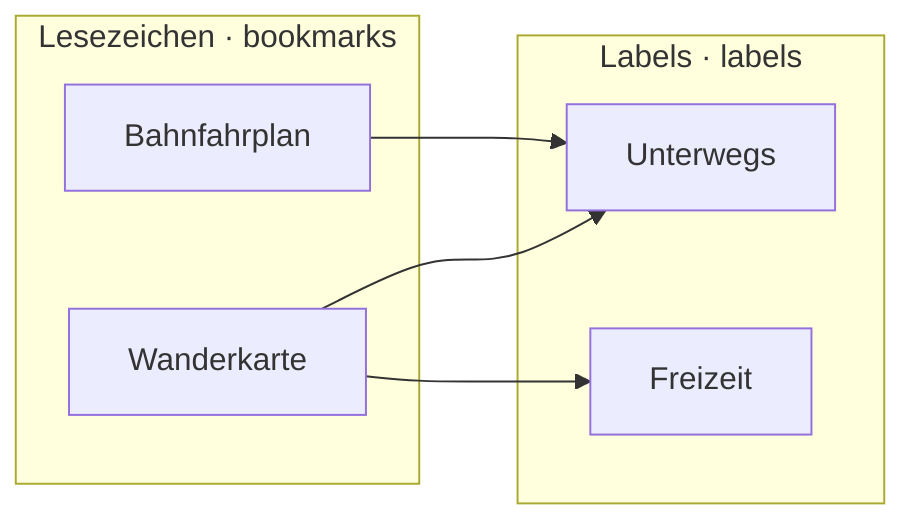

# Was steckt in einer Bibliothek?

Name und Farbe stehen am Label. Jedes Lesezeichen speichert in `labelIds` die IDs seiner Labels.

Browserspeicher und Sicherungsdatei verwenden dasselbe JSON-Format (Version 3).

| Datentransfer | Verhalten |
| --- | --- |
| Export | Enthält Lesezeichen und alle Labels, auch ungenutzte. PIN und Einstellungen bleiben im Browser. |
| Import | Lehnt ungültige Dateien vollständig ab. Fügt neue Lesezeichen in Dateireihenfolge vorne ein. Bei bekannten Lesezeichen-IDs bleibt die lokale Fassung erhalten. |
| Labels beim Import | Ordnet Labels zuerst per ID, dann per Name zu. Bereits vorhandene Labels behalten ihren Namen und ihre Farbe. |

[Datenmodell und Dateiformat](../../src/bookmarks/model.ts) · [Import und Export in den Einstellungen](../../src/settings/view.ts)

[← Architekturübersicht](../../ARCHITECTURE.md)
