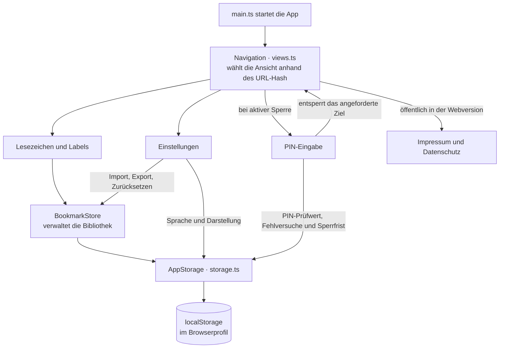
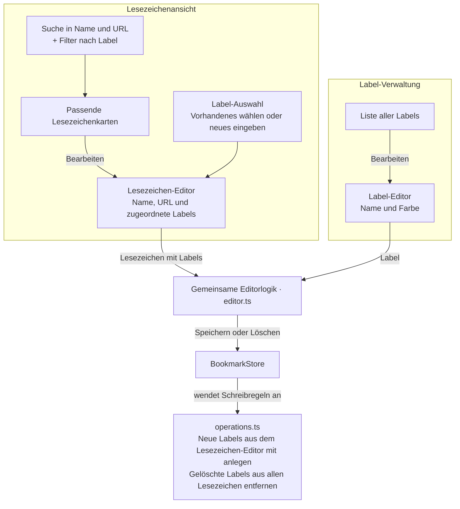

# Wie greifen die Teile im Browser ineinander?

Die PIN sperrt den Zugang zu den Ansichten. Die Bibliothek liegt auch bei aktiver PIN im Klartext vor.

[Navigation](../../src/views.ts) · [PIN-Prüfung mit Web Crypto](../../src/pin/model.ts) · [Sprachkataloge DE und EN](../../src/i18n/) · [Oberflächenstile](../../src/styles.scss)

## Lesezeichen und Labels im Detail

[Lesezeichenansicht](../../src/bookmarks/view.ts) · [Label-Auswahl](../../src/labels/picker.ts) · [Label-Verwaltung](../../src/labels/view.ts)

[← Architekturübersicht](../../ARCHITECTURE.md)
