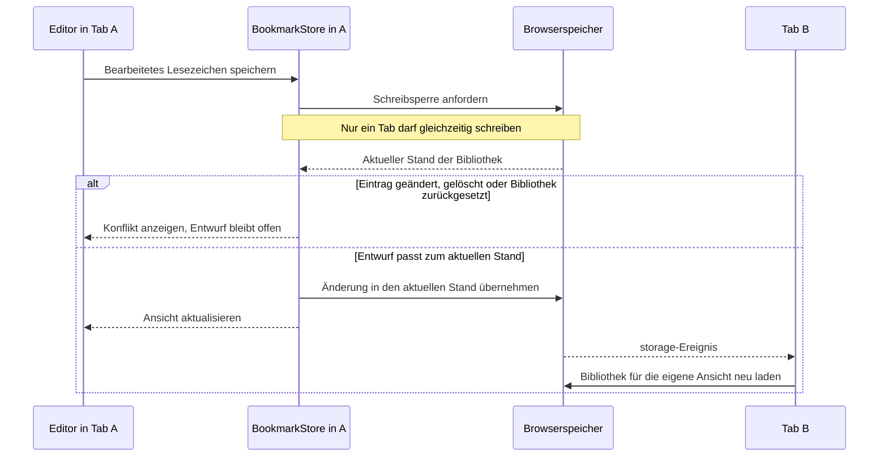

# Was passiert, wenn zwei Tabs gleichzeitig speichern?

Die Schreibsperre verwendet Web Locks. Fehlen sie im Browser, übernimmt eine IndexedDB-Transaktion die Sperre. Beim Zurücksetzen erhält die Bibliothek eine neue Kennung, an der offene Editoren veraltete Entwürfe erkennen.

[Editor](../../src/bookmarks/editor.ts) · [Schreibregeln](../../src/bookmarks/operations.ts) · [BookmarkStore](../../src/bookmarks/store.ts) · [Speicheradapter und Sperre](../../src/storage.ts)

[← Architekturübersicht](../../ARCHITECTURE.md)
